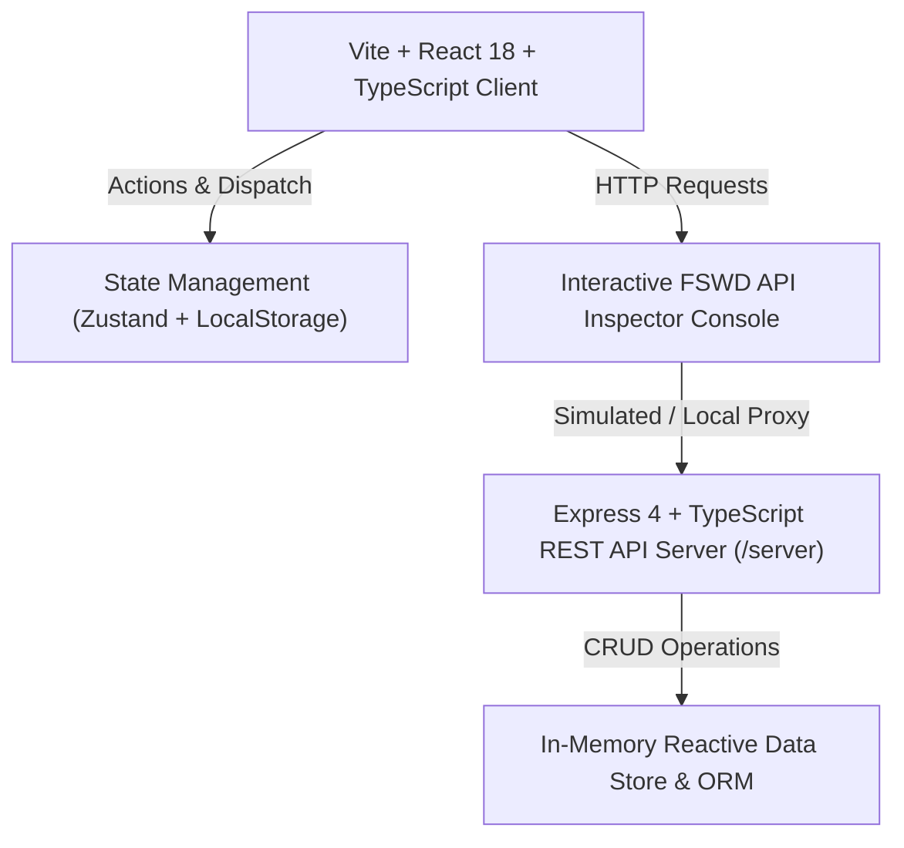

## 🏗️ Full-Stack Architecture (FSWD)



### Dual Full-Stack Execution
1. **Interactive Client Telemetry Runner**: A live, floating **FSWD API Inspector Console** embedded directly into the application. Hiring managers and evaluators can inspect live HTTP network calls (endpoints, latency, headers, JSON payloads), trigger API runs, and review system architecture live on GitHub Pages.
2. **Dedicated Node/Express TypeScript Microservice (`/server`)**: Complete backend server with modular routes (`/api/products`, `/api/orders`, `/api/auth`, `/api/coupons`, `/api/analytics`, `/api/health`), JWT authentication middleware, and input validation.

---

## 🚀 Key Functional Capabilities

### 1. Product Discovery & Listing (`/shop`)
- **Instant Search**: Debounced search with shortcut `/` and real-time query matching.
- **Multi-Factor Filtering**: Category selection, dynamic range slider, minimum rating threshold, and in-stock toggle.
- **Dual Presentation**: Responsive toggle between Grid view and detailed List view.
- **Pagination & Infinite Scroll**: Seamless toggle between standard numbered pagination and continuous infinite loading.
- **Quick View Modal**: Inspect variants, image previews, and specifications without leaving the catalog.

### 2. Product Detail & Customization (`/product/:id`)
- **Interactive Image Gallery**: Main photo with cursor-follow hover magnifier, thumbnail switcher, and fullscreen lightbox modal.
- **Variant Swatches**: Dynamic color finishes and hardware configurations with real-time price updates.
- **Stock Counter**: Live stock level feedback.
- **Customer Reviews & Ratings**: Star breakdown percentage bars, verified review list, and optimistic review submission modal.
- **Express Checkout**: Single-click "Instant Buy" express checkout option.

### 3. Shopping Cart & State Persistence (`/cart`)
- **Mini-Cart Drawer**: Global slide-out drawer accessible from anywhere in the app.
- **Free Shipping Gamification**: Dynamic progress meter toward the \$150 free delivery milestone.
- **Coupon Engine**:
  - `WELCOME10` — 10% off storewide
  - `CHROMA20` — 20% off high-tier studio gear
  - `FREESHIP` — 100% waiver on freight delivery
- **Complete Persistence**: Backed by `localStorage` to preserve user carts across page refreshes and browser sessions.

### 4. 3-Step Validated Checkout (`/checkout`)
- **Step 1 — Recipient & Shipping**: Full name, email, phone, and complete postal address with real-time validation.
- **Step 2 — Shipping Tier Selection**: Standard Freight vs. Priority Air Express.
- **Step 3 — Secure Payment**:
  - Credit/Debit card with **interactive virtual card preview** that updates dynamically as you type.
  - Express UPI QR Code with simulated payment authentication.
- **Realistic Payment Simulation**: Multi-stage progress indicators (`Connecting 256-bit TLS` -> `Authorizing gateway` -> `Securing escrow`).

### 5. Order Tracking & History (`/orders`)
- **Generated Order Numbers**: Unique tracking numbers (`CRX-XXXXX`) and courier tracking barcodes (`TRK-FEDEX-XXXXX`).
- **Status Lifecycle**: Visual tracking stages (`Processing` -> `Shipped` -> `Delivered`).
- **One-Click Reorder**: Add past order items back into the bag with a single tap.

### 6. Bonus Engineering Features
- 🛡️ **User Authentication**: Mock JWT bearer token authentication with instant demo user sign-in.
- 💖 **Wishlist System**: Save coveted editions and move all to bag with 1 click.
- ⚖️ **Product Comparison Drawer**: Compare specs and acoustic metrics side-by-side.
- 👁️ **Recently Viewed Rail**: Context-aware product rail tracking browsing history.
- 🛠️ **Floating API Inspector**: Live network traffic monitor with latency measurements and JSON payloads.

---

## 💻 Tech Stack

| Layer | Technologies |
|---|---|
| **Frontend Framework** | React 18, TypeScript, Vite |
| **Styling & Theme** | Tailwind CSS 3, Custom Chromatic Palettes, Headless UI |
| **State Management** | Zustand (with persistent localStorage middleware) |
| **Routing** | React Router v6 |
| **Icons & Media** | Lucide React, Unsplash Curated CDN |
| **Backend Framework** | Node.js, Express, TypeScript |
| **API Architecture** | RESTful JSON API with CORS, JWT Bearer Auth |
| **Deployment** | GitHub Actions (`deploy.yml`), GitHub Pages (`gh-pages`) |

---

## 🏃 Quick Start (Local Development)

### Prerequisites
- Node.js (v18 or higher)
- npm or yarn

### 1. Clone the repository
```bash
git clone https://github.com/guhan-art/E-Commerce.git
cd E-Commerce
```

### 2. Install dependencies
```bash
npm install
cd server && npm install && cd ..
```

### 3. Run development servers
```bash
# Run the frontend application (Vite on http://localhost:5173)
npm run dev

# In a second terminal, run the standalone Express REST server
npm run dev:server
```

### 4. Build for production
```bash
npm run build
npm run build:server
```

---

## 📄 License
MIT License © Guhan Raj S
